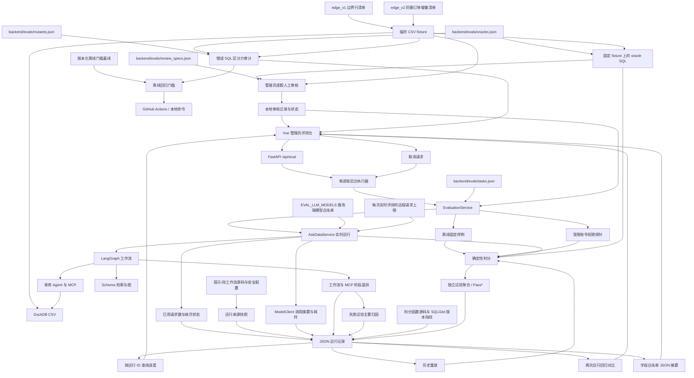
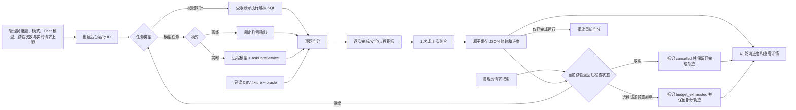
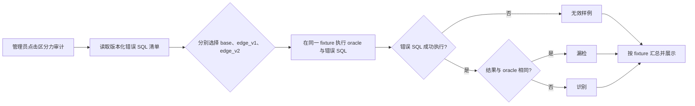
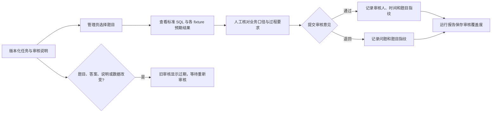

# 评测系统结构与流程

## 项目结构图

各阶段职责：任务定义输入和预期；runner 为每次试验隔离会话并收集输出；oracle 在固定数据集上计算标准结果；grader 验证路由、结果、SQL 表与安全；权限探针用受限账号直接验证数据库边界；记录保留逐题逐试验轨迹；UI 展示汇总和失败细节。

回归对比读取两份已完成记录，先校验任务版本、fixture 指纹、标准答案指纹、模式和试验次数，再对共同题按 ID 比较聚合判分及各项检查；只在一侧出现的题单独列出。对比不执行模型或 SQL。

新运行另存确定性判分函数及 SQLGlot 版本的 `grader_hash`。两次哈希都存在且不同则拒绝直接比较；旧记录缺少哈希时允许查看，但明确标为无法确认。重放使用当前判分器，返回 `replay_grader_hash`，保留原始哈希及历史记录。该指纹说明规则是否相同，不说明规则是否已由人工校准。

实时运行还记录提示词相关源码、工作流源码的指纹与非敏感模型配置。回归对比不要求两次实现相同，但会列出变化；旧记录缺少快照时显示版本信息不足。离线演示标为 `demo`，不声称运行了实时 Agent。

管理员可从服务端白名单选择实时评测的 Chat 模型。排队时冻结所选模型与配置，评测专用服务使用它执行；普通问数仍使用原配置。Embedding、Rerank、远程地址和密钥沿用同一服务。白名单由 `EVAL_LLM_MODELS` 配置，未设置时仅显示当前 `LLM_MODEL`。管理员分别运行两次后，在回归对比中查看模型及来源差异。

题目清单与标准 SQL 分开存放。`edge_v1` 根据原始 CSV 和版本化边界行清单重建临时数据；`edge_v2` 在 v1 之上再追加同地区、不同订单的同额实付记录。Agent 工具、权限探针和 oracle 在同一 fixture 上运行；原始数据不变，v1 指纹保持稳定。

任务集 v5 含 14 道开发集题。每题有审核说明，管理员可预览标准 SQL 与三套 fixture 的预期结果，再提交通过或退回及意见。审核记录本地持久化；任务、单题 oracle、审核说明或 fixture 指纹改变时旧审核标为过期。评测记录保存当时所选题的审核覆盖度；尚未建立独立保留集。

区分力审计将版本化错误 SQL 与 oracle 在 `base`、`edge_v1`、`edge_v2` 上分别执行。只有 SQL 成功执行且结果不同才算识别；执行失败单列为无效。管理员可在评测台触发审计，过程只用本地 DuckDB，不调用模型。

评测专用 ModelClient 记录远程调用类型、耗时、重试及供应商返回的 token 用量。试验总耗时单独按墙钟测量。记录不含密钥、Prompt、请求 URL 或响应正文；缺失 token 用量保持未知。

管理员可把已完成、已取消或预算耗尽的运行导出为带格式版本的 JSON 摘要。导出从历史记录筛选版本、判分、调用、阶段指标与请求预算，不带原始问题、SQL、数据行、模型正文或异常文本；不重新执行模型或 SQL。

实时评测默认最多发送 50 次远程 HTTP 模型请求，管理员页面可选 20、50 或 100 次；后端限制为 1–100 次。Chat、Embedding、Rerank 与重试都计入。用满后需要继续发送时，运行标记 `budget_exhausted`，保留已有试验和阶段轨迹并停止后续试验；已耗尽运行不能重放或参与已完成运行的回归对比。预算是请求次数上限，不是费用上限。

失败试验的主要归因优先指出失败的 MCP 工具子阶段，否则指向最早失败的工作流阶段；没有阶段异常时区分判分未通过和评测执行异常。归因用于缩小排查范围，并随重放重新计算。旧记录没有阶段数据时不补造归因。

离线门槛将任务、oracle、错误 SQL 与 fixture 指纹固定在 `backend/evals/offline_gate.json`，并检查已登记错误 SQL 的有效性及边界数据区分力。GitHub Actions 先生成确定性 CSV，再运行后端测试与门槛、前端类型检查与构建；不运行模型评测。

## 单次运行流程图

离线模式用于完整体验评测流程，不表示真实模型能力；实时模式需要 API Key 并可能产生费用。权限探针无论模式都单独运行一次。后台单线程顺序运行，每次试验后保存进度，UI 轮询。当前限定单 FastAPI 进程；多实例需要共享队列。

取消只作用于后台运行。管理员请求取消后，运行器在当前试验返回或下一试验开始前停止；已完成的试验保留，未做完全部独立试验的题标记为未完成且不计通过。取消后状态为 `cancelled`，不能重放或比较；单次正在等待的远程请求不会被强行中断。

## 评测集区分力审计流程

审计不运行 Agent，不调用模型，也不写入历史运行记录。它只检验已列出的典型错误；新增任务时应同步补充错误样例与边界数据。

## 人工审核流程

审核记录与自动判分分开：管理员确认题目依据，不改变某次 Agent 输出的通过与否。所有题初始为待审核，当前 14 题均属于开发集；独立保留集仍是后续工作。

## 下一步最值得改进

1. 由项目管理员实际审核现有 14 题，再扩充真实业务问法与独立保留集；审核说明本身不等于人工核验。
2. 扩充错误 SQL 样例和独立数据版本，尤其是 JOIN 重复、错误聚合粒度与跨数据库权限；当前 14 条样例在 `edge_v2` 全部被识别，不代表覆盖所有错误。
3. 已增加实时评测的 LangGraph 阶段、MCP 工具子阶段耗时与模型调用阶段标签；后续可结合实际失败样例完善原因分类。MCP 子阶段耗时包含在单库 Agent 耗时内。
4. 在已有来源快照与模型/Prompt 差异展示基础上，加入可控实验配置和断点恢复；当前无法从 UI 临时切换模型或提示词。
