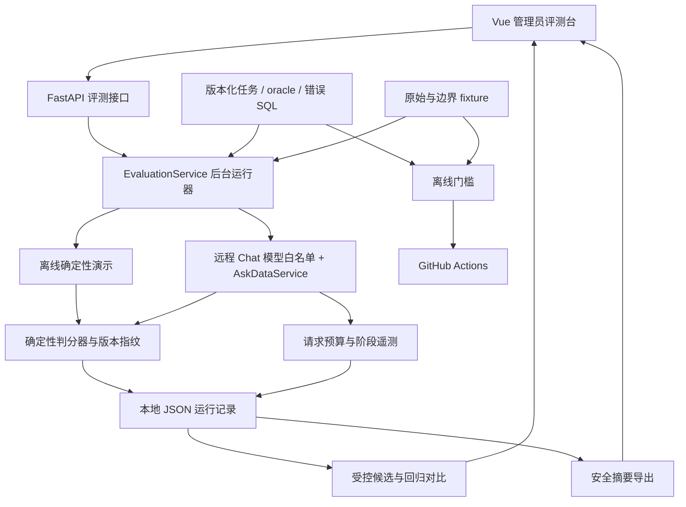
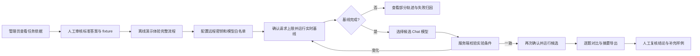

# 评测首版工程阶段验收

状态：工程流程已完成，2026-10-31。对应[评测路线图](evaluation-roadmap.md)与[第二十阶段决策](evaluation-v20-decisions.md)。本页用于按顺序体验流程；更完整的节点和数据流见[评测结构与流程](evaluation-architecture.md)。

## 项目结构图

## 使用流程图

## 首版验收范围

| 环节 | 已具备的能力 | 实际使用时要做的事 |
| --- | --- | --- |
| 任务质量 | 14 道开发集任务、三套 fixture、错误 SQL 区分力审计、逐题审核入口 | 管理员核对业务口径、标准 SQL 和预期结果，留下审核意见 |
| 离线体验 | 演示、判分、Pass³、进度、取消、重放、对比、导出 | 先用离线模式熟悉操作；演示分数不代表模型能力 |
| 实时评测 | 远程模型白名单、请求预算、阶段轨迹、失败归因、来源与判分指纹 | 配置 API Key，选择少量题目并主动确认运行 |
| 受控 A/B | 从已完成基线复制固定条件，选择候选模型，自动关联并填入对比 | 对两次运行分别确认；复核逐题差异和用量覆盖 |
| 自动化 | 后端测试、固定数据与错误 SQL 门槛、前端构建、GitHub Actions | 每次推送后检查 CI；真实远程模型评测仍由管理员触发 |

## 仍需人工完成

当前题目属于开发集，审核说明不等于已经审核。项目管理员需要逐题确认后才能形成可信的小型人工核验集；之后才能准备独立保留集和人工标注轨迹，校准判分器并评估真实模型能力。当前环境未配置远程 API Key，因此本阶段没有产生真实模型成绩或费用。

首版使用单进程后台执行器。本地演示与少量受控评测可用；服务重启会把未完成运行标记中断，后续可按真实使用需求再加入持久队列。候选模型共用当前服务的密钥与地址，记录只保存地址哈希；跨运行更换 API Key 所代表的服务账户无法由系统自动判断，需要管理员保持实验环境一致。
