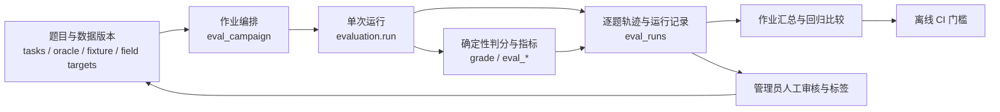

# 开源评测平台结构调研与本项目映射

调研日期：2026-11-10。目的：在实现自动化评测作业前，核对成熟平台如何组织数据集、执行、判分、轨迹和回归门槛。本项目保留现有 FastAPI、DuckDB 与 Vue 架构，不为这一增量部署外部中台服务。

| 来源 | 观察到的结构 | 本项目采用的做法 |
| --- | --- | --- |
| [OpenJudge：GradingRunner](https://agentscope-ai.github.io/OpenJudge/running_graders/run_tasks/) | runner 负责数据映射、grader 编排、并发和聚合；grader 自身负责判分。 | `eval_campaign.py` 负责分片与作业状态，现有 `evaluation.py` 负责单次运行，`grade` 和指标模块负责判分。第一版顺序执行，远程预算优先于吞吐量。 |
| [Claw-Eval：任务与批量运行](https://github.com/claw-eval/claw-eval) | 人工核验任务带 fixture；按完整轨迹审核完成度、安全与稳定性；批量命令可指定重复试验。 | 保留人工审核、fixture 指纹、阶段轨迹和 Pass³；作业层记录每片运行 ID，重复试验仍由现有运行器执行。 |
| [Langfuse：评测概念](https://langfuse.com/docs/evaluation/overview)与[实验比较](https://langfuse.com/docs/evaluation/experiments/compare-experiments) | 数据集、实验、逐项分数、轨迹和人工标注形成闭环；回归门槛应使用固定数据与评分版本、已批准基线，并检查缺失案例。 | `tasks.json`、oracle、fixture 与目标字段构成版本化输入；运行记录保留逐题轨迹；作业计划固定任务、数据、答案、判分器和字段标签指纹。当前 CI 只执行确定性门槛，模型基线门槛需真实运行与人工批准后再接入。 |
| [LangSmith：评测类型](https://docs.langchain.com/langsmith/evaluation-types) | 区分离线基准、单元测试、在线监测；代码、LLM Judge、汇总和成对比较是不同评测方法。 | 保持工程测试、离线 SQL/fixture 审计与真实模型评测三个分母；自然语言 Judge 仍待人工标签校准。 |

## 接入结构

作业是多个现有运行的编排层，不再新建第二套 oracle 或 grader。每片运行保留原始证据，作业摘要只汇总完成片；中断、失败和预算耗尽不作为通过。实时作业需要显式远程开关、总请求预算和已审核任务。数据集与评测定义有变动时使用新作业 ID。管理员页展示只读作业进度；真实模型基线门槛、计划任务和生产轨迹抽样留待后续。

## 与“中台”定位的关系

当前 `ecommerce_ops` 的 50 张合成 CSV、Schema、检索索引和权限控制属于可复用数据层，尚无通用接入、质量治理、血缘和数据服务目录，故不称完整数据中台。现有管理员评测页、任务/fixture、判分、轨迹、人工审核及 CI 构成评测台基础；补齐作业编排和运行治理后可称项目内的轻量评测平台，仍未达到跨团队多租户评测中台的范围。
